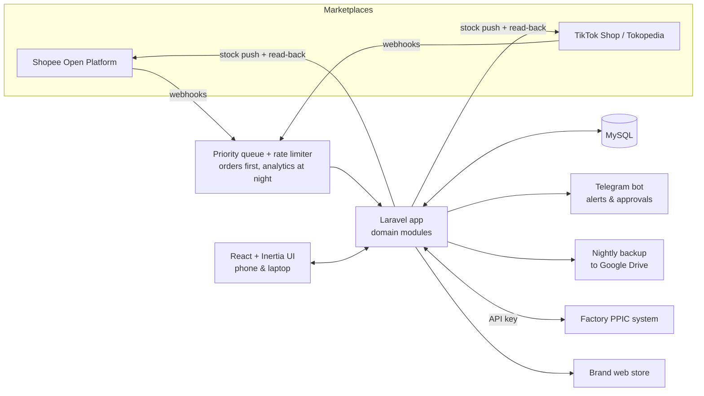

# Moaya Ops — the operating system of a growing bag brand

> **Showcase repository.** The production source code is private. This repo holds a description of the system, an architecture diagram and a few rewritten, runnable code samples. It contains no production code, data, credentials or internal business figures.

[Moaya](https://moaya.co.id) is an Indonesian backpack and bag brand that sells mostly on Shopee and TikTok Shop / Tokopedia, plus its own web store. **Moaya Ops** is the internal web app the whole team works in every day: orders and packing, warehouse, stock sync to the marketplaces, production with the partner factory, finance, marketing data, customer chat and the web store.

## The problem it solves

- **One stock number, many copies.** Work lived in monthly spreadsheets. Each copied its opening balance by hand, so stock drifted and nobody knew which number was right.
- **Marketplace stock out of sync.** Orders and stock sync ran on a third-party tool with a monthly order quota. When the quota ran out, the stock shown on the marketplaces went stale and risked overselling.
- **Profit was invisible.** Marketplace fees, ad spend, packaging and production cost lived in different places, so profit per order and per product could not be seen.

## What it does

| Area | Highlights |
|---|---|
| **Orders & packing** | Pulls orders from Shopee and TikTok Shop through webhooks and delta sync. Arranges shipping, prints labels, then scans each parcel and its items at packing. Flags wrong courier, double scans and late shipments. Works in fixed processing rounds. |
| **Warehouse portal** | Phone-first screens for receiving goods, stock movements, rejects, packaging stock, stock-taking (opname) and returns. One SKU format for the whole company. |
| **Stock push** | Sends a per-store stock number derived from real sellable stock with configurable rules (percentage, fixed add, safety threshold, promo-lock aware). Reads every listing back after the push. → [`examples/StockPush.php`](examples/StockPush.php) |
| **Production** | Purchase orders to the partner factory, delivery notes, quality-check results, lead times and reorder suggestions. Exchanges data with the factory's PPIC system through API keys. |
| **Finance portal** | Separate portal with 2FA: cash book matched to bank statements, marketplace payouts, payables to vendors, profit & loss by working month, tax helper. |
| **Sales & marketing** | Sales per product / channel / hour, funnel and traffic sources, affiliate creators and samples, campaign and promo overview, price-guard warnings. |
| **Chat portal** | One inbox for marketplace buyer chats, with templates, suggested replies and order tracking beside the chat. |
| **Web store & site** | The brand's own catalogue site with checkout, managed from the same app and sharing the same stock. |
| **"One place" cards** | Product, Order, Production Partner and Store cards that bring every related number into one page (stock, production, listings, push rules, history). |
| **Team** | Roles and permissions, tasks and KPIs, attendance, Telegram notifications for approvals and alerts. |

## Architecture



## Engineering choices worth mentioning

- **Every feature that writes to a marketplace ships switched off.** Only the owner turns a switch on, after a shadow run that compares the app's decisions with the old tool.
- **Read-back after every push.** A monitor checks each listing every few minutes and can pause stock sync on its own. One lesson: compare against *total* stock, because campaigns lock part of it. → [`examples/ReadBack.php`](examples/ReadBack.php)
- **Rate-limit aware sync.** Separate limiter buckets per API group, priority lanes and back-off, so a busy analytics job never delays an order.
- **Privacy by default.** Buyer names, phones and addresses are not stored beyond what shipping needs. They are masked for roles that do not need them, and never appear in notifications or logs.
- **Dated facts.** Prices, product costs and marketplace fee rates are versioned with an effective date, so old reports never change.
- **Audit everything.** Every write is logged with who, when, before and after.
- **Release discipline.** 115+ releases in about two months. Each one runs the full automated test suite (1,500+ tests), takes a database backup first and goes live outside order-processing hours.

## Tech stack

Laravel 12 (PHP 8) · React + Inertia + TypeScript · Vite · MySQL · queue workers · PHPUnit & Playwright · Nginx on a VPS · Shopee & TikTok Shop APIs (webhooks) · Telegram Bot API · Google Drive API · TOTP two-factor sign-in. Built with Claude Code as an AI pair programmer.

## Code samples

The samples are rewritten from scratch for this repo and use demo data only.

```bash
php tests/run.php
```

- [`examples/StockPush.php`](examples/StockPush.php): the most specific rule wins, rounding down, a safety threshold, holding when a campaign reserves more than we would show.
- [`examples/ReadBack.php`](examples/ReadBack.php): green / yellow / red after reading a listing back.

## Ringkasan (Bahasa Indonesia)

Moaya Ops adalah aplikasi web internal brand tas Moaya. Isinya proses pesanan Shopee & TikTok, gudang, kirim stok otomatis ke marketplace, produksi dengan pabrik mitra, keuangan, data pemasaran, chat pembeli, dan webstore, semuanya dalam satu sistem dengan satu angka stok. Repo ini hanya etalase: kode produksi tetap privat, dan tidak ada data asli di sini.

---

© 2026 M Dzaky Rahadian. All rights reserved. The samples are published for reading and review.
